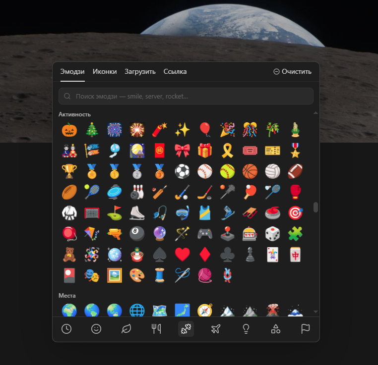

# NaitFlow

[English](README.md) | **Русский**

**0.1.75 Alpha** · В активной разработке

NaitFlow добавляет в Obsidian работу со страницами и блоками в духе Notion. Во вкладке **«Страницы NaitFlow»** видно дерево страниц и подстраниц с иконками. Рядом доступен файловый менеджер Obsidian для работы с папками и Markdown-файлами того же хранилища.

## Что нового в 0.1.75 Alpha

- Горизонтальная панель форматирования и меню вставки блоков по `/` в динамическом просмотре.
- Выделение целых блоков с полей редактора и перетаскивание с линией вставки.
- Обновлённые маркеры списков, выравнивание и отступы.
- Иконки страниц в дереве и навигационной цепочке, предпросмотр ссылок на подстраницы.

Также в NaitFlow есть галереи обложек, собственные иконки страниц, корзина и импорт из экспорта Notion, экспорта Buildin Markdown и через Notion API.

## Ручная установка

Скопируйте `main.js`, `manifest.json`, `styles.css`, `NotoColorEmoji.ttf`, `NotoColorEmoji-LICENSE.txt` и каталог `presets` в `.obsidian/plugins/naitflow`. Перезапустите Obsidian и включите NaitFlow в разделе «Сторонние плагины».

Требуется Obsidian 1.8.0 или новее. Совместимость с iOS пока не подтверждена. См. [сведения о сторонних ресурсах](THIRD_PARTY_NOTICES.md).

## Поиск в Unsplash

NaitFlow не содержит общего ключа Unsplash. Для личного использования поиск обложек настраивается так:

1. Войдите на сайт [Unsplash Developers](https://unsplash.com/oauth/applications/new).
2. **Подтвердите адрес электронной почты в аккаунте Unsplash до создания приложения.** Без подтверждения форма с названием и описанием может просто не сработать.
3. Вернитесь на страницу [New Application](https://unsplash.com/oauth/applications/new), прочитайте и примите условия API.
4. Создайте приложение. Рекомендуемые значения:
   - **Application name:** `NaitFlow`
   - **Description:** `Cover image search and selection for the NaitFlow Obsidian plugin.`
5. Откройте **Your apps → NaitFlow** и прокрутите страницу до раздела **Keys**. Там будут указаны **Application ID**, **Access Key** и **Secret Key**.

6. Скопируйте только **Access Key**. Application ID и Secret Key плагину не нужны.
7. В Obsidian откройте **Настройки → NaitFlow → Unsplash Access Key** и вставьте ключ.

Никогда не публикуйте **Secret Key** в NaitFlow, на скриншотах, в обсуждениях или в GitHub. Access Key сохраняется в настройках плагина этого хранилища (`.obsidian/plugins/naitflow/data.json`), поэтому этот файл и его синхронизированные копии также следует считать конфиденциальными.

Новые приложения Unsplash начинают работу в демонстрационном режиме с ограниченным числом запросов. Такая схема с личным ключом предназначена для локального использования и разработки. Встраивать один общий ключ в плагин нельзя: файлы плагина, включая `main.js`, доступны пользователю и не могут надёжно скрыть ключ.

Справка: [документация Unsplash API](https://unsplash.com/documentation) и [правила использования Unsplash API](https://help.unsplash.com/en/articles/2511245-unsplash-api-guidelines).

## Источники и лицензии

Встроенный шрифт [Google Noto Color Emoji](https://github.com/googlefonts/noto-emoji) распространяется по лицензии SIL Open Font License 1.1. Текст лицензии находится в файле `NotoColorEmoji-LICENSE.txt`.

Источники встроенных обложек перечислены в файлах `SOURCES.md` внутри каталогов пресетов. Изображения NASA используются в информационных целях и не означают поддержку проекта со стороны NASA. Работы MET из встроенной коллекции находятся в общественном достоянии и опубликованы программой Open Access.
